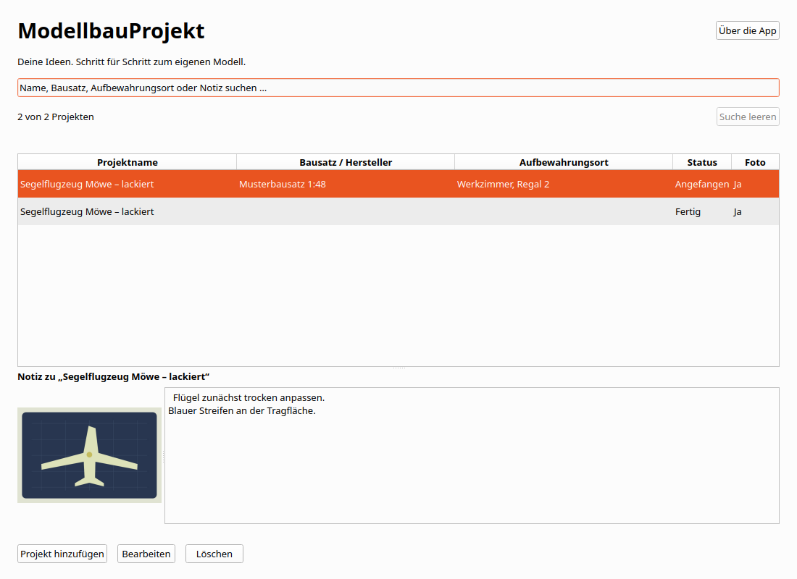

# Model Building Projects

## Linux-Anwendungsmenü und Dock

Nach dem Entwicklungsbuild registriert dieser Befehl die App im aktuellen
Benutzerkonto:

```bash
python3 scripts/install_desktop.py --development
```

Danach erscheint **Model Building Projects** mit dem eigenen Icon im Anwendungsmenü und Dock.
Der Menüeintrag startet den vorhandenen Entwicklungsbuild über
`scripts/launch.sh`. Dieser baut nichts neu. `scripts/run.sh` baut weiterhin
und startet anschließend die App. Bei fehlendem Build zeigt der Starthelfer
eine Fehlermeldung auf stderr.

Der Installer schreibt ausschließlich den eigenen Desktop-Eintrag und Icons
unter `$XDG_DATA_HOME`, standardmäßig `~/.local/share`. Wiederholtes Ausführen
aktualisiert verwaltete Einträge. Fremde Einträge werden nicht überschrieben.
Die normale Sammlung und Spracheinstellung bleiben erhalten.
`--data-dir /absoluter/testpfad` ist nur für einen ausdrücklich gewünschten
abweichenden Startpfad nötig.

Ein eigenständiges Linux-Paket enthält denselben Installer. Im Paketordner
genügt `python3 install_desktop.py`. Alternativ ist
`python3 scripts/install_desktop.py --app-dir /absoluter/paketpfad` möglich.
Dabei verweist der Menüeintrag auf `ModelBuildingProjects.sh` und die paketierte Laufzeit.

Die bestehenden Motive bleiben unverändert. Zusätzliche PNG-Größen können
mit `python3 scripts/prepare_icons.py` erzeugt werden. Dafür ist Python mit
Pillow erforderlich, für Installation und App-Start nicht.

## Sammlung, Information und Sprache

Hinzufügen steht oben rechts. Unter der Tabelle stehen Bearbeiten und Löschen.
Die Spaltenüberschriften sortieren auf- und absteigend. Textspalten verwenden die
aktuelle Sprache und eine natürliche Zahlenreihenfolge. Status folgt der Reihenfolge
geplant, angefangen, fertig. Die Auswahl bleibt erhalten.

Info enthält getrennte Fenster für Über die App, Datenschutz und Lizenzen.
Alle Inhalte sind offline verfügbar. Neue Installationen verwenden die unterstützte
Systemsprache mit Englisch als Fallback. Gespeicherte Sprachwahlen bleiben erhalten.

Exportieren sichert die gesamte gespeicherte Sammlung als JSON mit eingebetteten
Originalfotos und dem Projektstatus. Importieren ergänzt
fehlende Exemplare nach Bestätigung. Vorhandene Einträge werden nicht überschrieben.
Erneuter Import derselben Datei legt keine zusätzlichen identischen Exemplare an.
Exportdateien enthalten keine Spracheinstellung oder internen Eintrags-IDs.

Eine Transferdatei darf höchstens 256 MiB und 10.000 Einträge enthalten.
Die bisherigen Fotogrenzen bleiben bestehen. Maximal eine Million Zeichen je Textfeld. Die Grenze verändert vorhandene Daten nicht.
Ein unvollständiger Import wird niemals gespeichert. Dateien anderer Apps und
unbekannte Formatversionen werden abgewiesen. JSON-Dateien sind nicht verschlüsselt.

Auf macOS wählst du erst einen Ordner und dann einen Dateinamen. Auf anderen
Plattformen öffnet sich der Speicherdialog. Vorhandene Dateien werden erst nach
Bestätigung und erneuter Prüfung ersetzt. Datenträger ohne Hardlinks werden für
neue Dateien unterstützt. Bei hartem Abbruch kann dort eine unvollständige neue
Datei zurückbleiben. Erstelle den Export dann erneut unter einem neuen Namen.


Kleine Modellbauprojekte an einem Ort. Erfasse Projektname, Bausatz oder
Hersteller, Aufbewahrungsort und eine mehrzeilige Notiz. Ein optionales Foto
und der Status **Geplant**, **Angefangen** oder **Fertig** zeigen den aktuellen
Stand. Alles bleibt lokal, ohne Konto und Internet.



Version 0.1.0 ist die dritte kleine C++-App des Hobby-Portfolios und ein
nachvollziehbares Bewerbungsprojekt. Veröffentlichungsziele sind ausdrücklich
**zuerst Microsoft Store und später Mac App Store für Mac-Computer**.
Es wurde noch nichts veröffentlicht oder bei einem Store eingereicht.

## Entwickeln und starten

C++20, Qt **6.8.3** Widgets, CMake ab 3.25 und Ninja. Qt Core, Gui, Widgets,
Sql und Test sowie LinguistTools, QSQLITE und JPEG-Plugin müssen aus derselben SDK-Version
und zum verwendeten Compiler passen. PNG ist im verwendeten Qt Gui enthalten.
Lokal geprüft: Ubuntu 24.04.4 x64, GCC 13.3.0, CMake 4.4.4 und Ninja 1.11.1.
Formatter ist clang-format 23.1.3, statische Prüfung clang-tidy 22.1.8.

Linux und macOS, aus diesem App-Verzeichnis:

```bash
export MODELLBAUPROJEKT_QT_ROOT=/absoluter/pfad/Qt/6.8.3/gcc_64
source scripts/env.sh
cmake --preset dev
cmake --build --preset dev --parallel 4
./build/dev/modellbauprojekt
```

Auf macOS auf das `macos`-SDK zeigen. Der Launcher liegt dort in
`build/dev/modellbauprojekt.app/Contents/MacOS/modellbauprojekt`.
Unter Linux baut und startet alternativ `bash scripts/run.sh` die App.
Für native GTK-Dateidialoge unter Linux `QT_QPA_PLATFORMTHEME=gtk3` setzen.
Ohne verfügbaren Plattformhelfer verwendet Qt seinen eigenen Dateidialog.
Auf Windows und macOS übernimmt die jeweilige Plattform die native Auswahl.

Windows in einer x64-Developer-PowerShell für Visual Studio 2022:

```powershell
$env:MODELLBAUPROJEKT_QT_ROOT = 'C:\Qt\6.8.3\msvc2022_64'
$env:CMAKE_PREFIX_PATH = $env:MODELLBAUPROJEKT_QT_ROOT
$env:PATH = "$env:MODELLBAUPROJEKT_QT_ROOT\bin;$env:PATH"
cmake --preset dev
cmake --build --preset dev --parallel 4
.\build\dev\modellbauprojekt.exe
```

Optionale Maschinenpfade gehören in die ignorierte `.tools/env.sh`.
Ein installiertes SDK darf für mehrere Projekte verwendet werden. Die fertige
App benötigt weder Entwicklerwerkzeuge noch eine separate Qt-Installation oder
eine andere Portfolio-App. Es gibt keine gemeinsame Runtime-Abhängigkeit.

## Sprachen

Deutsch, Englisch, Spanisch, Französisch, Italienisch und brasilianisches
Portugiesisch stehen unter „Sprache“ oder Strg+, zur Wahl. Die Auswahl gilt ab
Neustart. Beim ersten Start folgt die App der Systemsprache, mit Englisch als
Rückfall. Namen, Notizen, Fotos und gespeicherte Statuscodes bleiben unverändert.
`language.txt` neben der Datenbank enthält nur die Einstellung. Native
Dateidialog-Schaltflächen können der Betriebssystemsprache folgen.

[Internationalisierung und Vorschauordner](docs/internationalization.md)
beschreibt die realen GUI-Prüfungen und Store-Assets.

## Bedienung

„Projekt hinzufügen“ und „Bearbeiten“ öffnen denselben Dialog. Nur der
Projektname ist erforderlich. Gleichnamige Projekte besitzen unabhängige IDs.
Doppelklick oder Enter in der Tabelle öffnet die Auswahl zur Bearbeitung.
Löschen verlangt eine Bestätigung. Notizen werden vollständig scrollbar angezeigt.

Neue Projekte beginnen mit „Geplant“. Alle drei Statuswerte können unmittelbar
ineinander geändert werden. Auch „Fertig“ zurück zu „Geplant“ oder „Angefangen“
ist erlaubt. Die Auswahl ändert zunächst nur den Entwurf. Erst Speichern
übernimmt Texte, Foto und Status gemeinsam. Farbe ist nicht erforderlich,
der Status erscheint als lesbarer Text in der Übersicht.

Die Suche berücksichtigt genau die vier Textfelder. Umlaute, Groß- und
Kleinschreibung sowie zusammengesetzte und zerlegte Unicode-Schreibweisen
werden berücksichtigt. „Suche leeren“ zeigt alle Projekte. Ein Hinweis erklärt,
wenn ein erfolgreich gespeichertes Projekt nicht mehr zur aktuellen Suche passt.

Genau ein JPEG- oder PNG-Foto kann hinzugefügt, ersetzt und entfernt werden.
Der Inhalt zählt, nicht die Dateiendung. Grenzen sind **10 MiB**, **6000 Pixel
pro Seite** und insgesamt **16 Millionen Pixel**. Die App liest begrenzt ein
und decodiert vollständig. Beschädigte und nicht unterstützte Dateien sowie
animierte PNGs werden abgewiesen. Die Vorschau bleibt proportional und
berücksichtigt vom Decoder unterstützte Bildorientierung.

Die eigenen Bildbytes liegen in SQLite. Die Quelldatei wird niemals verändert
und nach dem Import nicht mehr benötigt. Abbrechen der Dateiauswahl und ein
Importfehler erhalten das bisherige Foto. Ein Lesefehler bei einem gespeicherten
Foto sperrt die Bearbeitung mit einem Hinweis, bis das Laden wieder gelingt.

Abbrechen, Escape und Fensterschließen schützen auch reine Foto- oder
Statusänderungen. „Weiterbearbeiten“ ist die sichere Vorauswahl. Ein vollständig
zurückgesetzter Entwurf schließt ohne Rückfrage. Speicherfehler erhalten alle
Eingaben zum erneuten Versuch. Während Import und Speichern bleiben konkurrierende
Aktionen gesperrt. Formulare scrollen bei kleinen Fenstern und großer Schrift.
Die Dialogschaltflächen bleiben außerhalb des scrollenden Bereichs erreichbar.

| Taste | Aktion |
| --- | --- |
| Strg+N / Cmd+N | Projekt hinzufügen |
| Strg+F / Cmd+F | Suche fokussieren |
| Enter oder Doppelklick in der Tabelle | Bearbeiten |
| Entf in der Tabelle, Cmd+Rücktaste auf macOS | Löschbestätigung |
| Strg+S / Cmd+S | Gemeinsamen Entwurf speichern |
| Escape | Dialog mit Verwerfschutz schließen |
| Enter im Notizfeld | Neue Zeile |
| Tab / Umschalt+Tab | Bedienelement wechseln |
| Pfeiltasten in der Statusauswahl | Status wählen |

Unter Windows und Linux sind zusätzlich beschriftete Alt-Kürzel verfügbar,
beispielsweise Alt+P für Projektname, Alt+S für Status, Alt+F für Fotoauswahl
und Alt+E für Foto entfernen. Native Plattformkürzel benötigen ihre native Abnahme.

## Daten und Sicherung

App-Kennung: `de.appfabrik.modellbauprojekt`. Die Datei
`modellbauprojekt.sqlite3` enthält alle Texte, Statuswerte und Fotos.
QStandardPaths bestimmt das benutzerspezifische Datenverzeichnis.
„Über die App“ zeigt den tatsächlich verwendeten Pfad.

| System | Typischer Pfad ohne Store-Sandbox |
| --- | --- |
| Linux | `$XDG_DATA_HOME/de.appfabrik.modellbauprojekt`, sonst `~/.local/share/de.appfabrik.modellbauprojekt` |
| Windows, noch nicht nativ geprüft | `%LOCALAPPDATA%\de.appfabrik.modellbauprojekt` |
| macOS, noch nicht nativ geprüft | `~/Library/Application Support/de.appfabrik.modellbauprojekt` |

Store-Virtualisierung und macOS-Sandbox können die Pfade ändern. Nutzerdaten
liegen außerhalb von Programm- und Quellcodeverzeichnis. Es gibt keine
Datenübernahme von anderen Apps. Eine zweite Instanz derselben Datenbank wird
abgewiesen. Andere Apps können gleichzeitig laufen.

Zum manuellen Sichern die App schließen und die SQLite-Datei kopieren.
`collection.lock` ist keine Nutzerdatenbank. SQLite kann entfernte Bilder als
freien Platz innerhalb der Datei behalten. Sofortige Verkleinerung und sichere
physische Löschung werden nicht zugesagt. Externe gleichzeitige Bearbeitung
ist kein unterstützter Ablauf.

Isolierter Teststart ohne Zugriff auf normale Benutzerdaten:

```bash
bash scripts/run.sh --data-dir /tmp/modellbauprojekt-eigener-test
bash scripts/check.sh
ASAN_OPTIONS=detect_leaks=1:halt_on_error=1 UBSAN_OPTIONS=halt_on_error=1 bash scripts/check.sh asan
```

`--data-dir` muss absolut und nicht leer sein. Fehler fallen niemals auf die
normale Datenbank zurück. Automatische Tests erzeugen temporäre Datenbanken
und synthetische Bilder.

## Architektur, Pakete und Portfolio

[Architektur und Bewerbungsgespräch](docs/architecture.md),
[Prüfbericht](docs/verification.md), [Paketierung](docs/packaging.md) und
[Komponenten- und Lizenzhinweise](THIRD_PARTY_NOTICES.md) beschreiben die Umsetzung.

| Stufe | Eigenständige App | Neue Hauptfunktion |
| --- | --- | --- |
| 1 | BrettspielRegal | Anlegen, Bearbeiten, Löschen und Textsuche |
| 2 | SammlerVitrine | Ein Foto pro Eintrag |
| 3 | Model Building Projects | Projektstatus |
| 4 | HolzwerkProjekt | Checkliste |
| 5 | RestaurierungsHeft | PDF-Export |

Jede Stufe behält die vorherigen Grundfunktionen. Diese App implementiert
nur Stufe 3. Keine Checklisten, PDF-Exporte, Teile- oder Farbenverwaltung,
Werkzeugbestände, Bauzeiten, Kosten, Fristen, Erinnerungen, Statistiken oder
Online-Anbindungen. HolzwerkProjekt und RestaurierungsHeft gehören nicht zu
diesem Repository. FactoryForge und PDF Batch Studio bleiben größere Einzelprojekte.

## JSON-Austauschformat

Formatkennung `model-building-projects.collection`, Version `1`, Eintragsliste `projects`.
Jeder Eintrag enthält `name`, `manufacturer`, `location`, `note` und `photoBase64`.
Ohne Foto ist `photoBase64` null, sonst enthält es die ursprünglichen Bildbytes
als kanonisches Base64. Interne Eintrags-IDs sind nicht Bestandteil des Formats.
Status wird als `status` mit `planned`, `started` oder `finished` gespeichert.
Dateien anderer Produkte, unbekannte Versionen und ungültige Felder werden
abgewiesen. Der bestätigte Import verwendet einen bereits validierten Snapshot.
