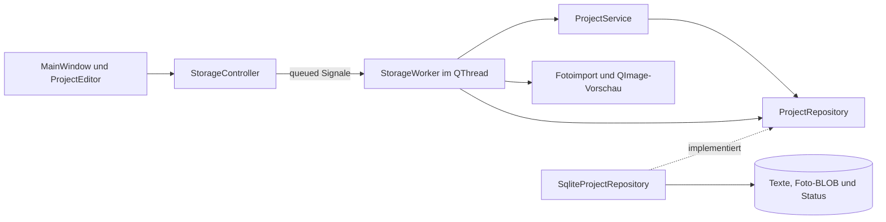

# Architektur und Bewerbungsgespräch

ModellbauProjekt hat ein CMake-Projekt mit kleinen internen Targets für
Modell und Service, Fotoimport, SQLite und Oberfläche. Die Muster aus
BrettspielRegal wurden app-lokal angepasst. StrickProjekt war das fachliche
Vorbild für Status und gemeinsamen Entwurf, GarnBox für Fotogrenzen.
Die parallel entstehende SammlerVitrine wurde ausschließlich gelesen.
Das übernommene Fotoimport-Muster wurde hier eigenständig geprüft.
Es gibt keinen gemeinsamen Portfolio-Kern und keine kopierte Git-Historie.

## Modell und Identität

`ProjectDraft` enthält vier QString-Texte, `ProjectStatus` und ein QByteArray
für das optionale Foto. Leere Bytes bedeuten kein Foto. Der Gleichheitsoperator
vergleicht sämtliche Werte einschließlich Bildinhalt und Status.
`ModelProject` ergänzt eine 64-Bit-ID und `hasPhoto`. SQLite erzeugt IDs mit
`INTEGER PRIMARY KEY AUTOINCREMENT`. Gleichnamige Projekte sind unabhängig.
Bearbeiten und Löschen benutzen die ID, niemals Namen oder Listenindex.

Listen enthalten zusammengefasste Werte. `summarize` entfernt Foto-BLOBs aus
bestätigten Schreibresultaten, `findAll` liest sie überhaupt nicht. `hasPhoto`
signalisiert das vorhandene Bild. Nur `find(id)` lädt einen vollständigen Entwurf.
Der Typ ist bewusst klein und wird für Entwurf und Zusammenfassung wiederverwendet.
Die dokumentierte Repository-Grenze und Tests erzwingen leere Listen-Bildbytes.
MainWindow hält höchstens die aktuelle Auswahl mit vollständigen Bildbytes.

`validateDraft` entfernt äußeren Unicode-Leerraum aus den einzeiligen Feldern.
Ein danach leerer Projektname ist ungültig. Die Notiz wird nicht getrimmt.
Der Klartexteditor verarbeitet Zeilenumbrüche in der üblichen LF-Darstellung.
NFC, Unicode-Case-Folding und erneutes NFC behandeln Umlaute und zerlegte
Schreibweisen gleich. Ein QCollator der aktiven App-Sprache sortiert mit natürlicher
Zahlenreihenfolge, die ID löst Gleichstände auf. Status ist kein Suchfeld.

## Der Status als fester Wertebereich

| C++-Enum | SQLite-Schlüssel | Deutsche Anzeige |
| --- | --- | --- |
| `ProjectStatus::Planned` | `planned` | Geplant |
| `ProjectStatus::Started` | `started` | Angefangen |
| `ProjectStatus::Finished` | `finished` | Fertig |

`enum class` verhindert beiläufige Integer-Verwendung. `storedStatus`,
`statusFromStorage` und `displayStatus` ordnen die Werte explizit zu.
Weder implizite Enum-Reihenfolge noch deutsche Texte gelangen in die Datenbank.
Unbekannte Speicherwerte und ungültige Enum-Werte werfen einen verständlichen
Fehler. Es gibt keinen stillen Ersatz durch Geplant.

Neue Entwürfe beginnen mit Planned. Eine nicht editierbare QComboBox enthält
exakt die drei lokalisierten Beschriftungen. Ihre Item-Daten enthalten den Enum-Wert,
keine Datenbankschlüssel oder abgeleitete Listenpositionen. Jede Änderung ist
zunächst nur Teil des Entwurfs. Alle Übergänge sind unmittelbar erlaubt.
Die Tabelle zeigt denselben Anzeigenamen als Text.

## Ein vollständiger Speichervorgang

1. Vor Bearbeitung eines Projekts mit Foto werden dessen Bytes und Vorschau
   im Worker geladen und geprüft. Ein Lesefehler sperrt die Bearbeitung,
   damit kein irrtümlich leerer Fotoentwurf bestehende Daten entfernt.
2. Der Editor hält ursprüngliche und aktuelle Texte, Bildbytes und Status.
   Foto hinzufügen, ersetzen oder entfernen und Statuswahl schreiben noch nichts.
3. Speichern validiert den Entwurf und übergibt eine Wertkopie über ein queued
   Signal. Der Service wählt anhand der ID zwischen Anlegen und Ändern.
4. Das Repository prüft die Foto-Bytes erneut und bindet Texte, nullable BLOB
   und expliziten Statusschlüssel an eine vorbereitete SQL-Anweisung.
5. Eine RAII-Transaktion umschließt INSERT oder UPDATE. Jeder vorzeitige Ausgang,
   auch ein Fehler beim Commit, führt zum Rollback. DELETE entfernt die Zeile
   einschließlich ihres Bild-BLOBs. Es gibt keine abzustimmenden externen Dateien.
6. Erst ein erfolgreicher Commit liefert eine bestätigte Zusammenfassung an
   die Oberfläche. Die Liste wird direkt aktualisiert. Der Dialog schließt erst
   danach. Keine nachgeschaltete Leseoperation kann ein bereits erfolgreiches
   Speichern irrtümlich als fehlgeschlagen melden.
7. Bei Fehlern bleibt der vollständige Entwurf offen und kann erneut gespeichert
   werden. Eine reine Statusänderung verwendet dieselben Texte und Bildbytes.

Alle Abbruchwege benutzen `requestClose`. Der Vergleich enthält die tatsächlichen
Bildbytes, keinen Pfad oder Dateinamen. Auch reine Status- und Fotoänderungen
lösen die Rückfrage aus. Vollständiges Zurücksetzen beseitigt sie.
„Weiterbearbeiten“ ist Standard- und Escape-Aktion. Das Hauptfenster fragt
über denselben Dialog nach und wartet bei laufender Mutation auf deren Abschluss.

Für ein Gespräch: „Ich speichere Texte, Bild und stabilen Statusschlüssel in
einer Transaktion. Ein Test hält eine zweite SQLite-Lesetransaktion offen.
Dadurch scheitert der Commit nach dem UPDATE tatsächlich. Der alte Datensatz
bleibt vollständig erhalten, der Editor behält alle neuen Werte und derselbe
Entwurf kann nach Aufheben der Sperre erfolgreich gespeichert werden.“

## Fotoimport und Ressourcenbegrenzung

Die native Dateiauswahl liefert einen vorübergehend benötigten Dateipfad.
Der Worker öffnet ausschließlich lesend und liest in Blöcken höchstens 10 MiB
plus ein Prüfbyte in das Ergebnis. Damit kann eine nachträglich gewachsene
Datei die Grenze nicht umgehen. QIODevice kann zusätzlich einen kleinen
internen Lesepuffer vorhalten. Dateifehler erhalten den bisherigen Entwurf.

QImageReader erkennt den Bildinhalt. Nur JPEG und PNG werden zugelassen.
Vor vollständiger Decodierung werden Abmessungen und das mit 64 Bit berechnete
Pixelprodukt geprüft. Grenzen sind 6000 Pixel je Seite und 16 Millionen Pixel.
PNG-Chunklängen, CRC und abschließendes IEND werden zusätzlich kontrolliert.
Animierte PNGs werden abgewiesen. JPEG muss vollständig eingerahmt sein.
Qt kann beschädigte JPEG-Daten mit einer Warnung teilweise reparieren.
Ein mutexgeschützter Diagnose-Scope behandelt solche Decoderwarnungen im
aktuellen Thread ebenfalls als Fehler und leitet fremde Meldungen weiter.
Die App installiert keine konkurrierenden Diagnose-Handler.

Erst nach vollständiger Decodierung entsteht eine proportionale QImage-Vorschau
bis 1000 Pixel je Seite. `setAutoTransform(true)` berücksichtigt unterstützte
Orientierung, etwa EXIF-Rotation bei JPEG. Die Originalbytes werden unverändert
gespeichert. Keine Bildbearbeitung und keine besondere Farbprofilaufbereitung.
Der Pixeldeckel bedeutet etwa 64 MiB für ein 32-Bit-Bild oder 128 MiB für
64 Bit pro Pixel, zusätzlich zu Decoderpuffern, Bytes und Vorschau. Qt kann
aufgrund seines eigenen Allokationslimits früher ablehnen. Decoderbibliotheken
sind keine eigenständige Sicherheits-Sandbox. Syntaktisch gültige Manipulationen
am Bildinhalt lassen sich durch Formatprüfung nicht erkennen.

## Ownership, RAII und Threadgrenzen

Qt-Parent-Ownership verwaltet Widgets. MainWindow hält den Editor als QPointer.
StorageController besitzt den QThread als Member. StorageWorker wird in diesen
Thread verschoben und über `finished` und `deleteLater` dort freigegeben.
Sein `std::unique_ptr<ProjectRepository>` erzeugt und zerstört auch die benannte
SQL-Verbindung im Worker. Jede QSqlQuery ist lokal. Erst werden SQL-Handles
freigegeben, danach wird die Verbindung aus Qt entfernt.

SQL, Sperrwartezeiten, Einlesen und Decodierung laufen seriell im Worker.
Qt Core-Werttypen, QByteArray und QImage sind Wertkopien an der Threadgrenze.
QByteArray verwendet Copy-on-write. Widgets und QPixmap entstehen ausschließlich
im GUI-Thread. PhotoView passt die bereits begrenzte Vorschau bei Größenänderungen
proportional an. Das Schema und der Repository-Vertrag enthalten keine Widgets.

Ein Generationstoken je Auswahlwechsel verhindert veraltete Vorschauen und
Fehlermeldungen. Alle Callbacks haben einen QObject-Empfängerkontext und erreichen
zerstörte Fenster nicht mehr. Import und Speichern sperren konkurrierende Aktionen.
Normales Schließen während des Imports wird verhindert. Außergewöhnlich zerstörte
Dialoge werden sicher abgetrennt. Die Tests prüfen auch späte Ergebnisse.

Sehr schnelle Auswahlwechsel können den einzelnen Worker mit veralteten
Leseaufträgen beschäftigen. Sie werden nacheinander beendet und deren Ergebnisse
ignoriert. Das ist eine bewusst kleine Lösung ohne weiteren Threadpool.
Beim Abbau wartet der Controller auf den geordneten Abschluss laufender Arbeit.

## Schema, Fehler und lokale Daten

Schema 1 umfasst `projects(id,name,manufacturer,location,note,status,photo)`.
Die app-eigene `application_id` ist `1296191537`, `user_version` ist 1.
Status besitzt NOT NULL, Default `planned` und einen CHECK für genau drei Werte.
Ein weiterer CHECK begrenzt Foto-Typ und Byteanzahl. Die Detailabfrage liest
übermäßig große gespeicherte BLOBs nicht in den Arbeitsspeicher.

Nur eine vorher nicht vorhandene Datei wird initialisiert. Existierende leere,
beschädigte, fremde oder unbekannt neuere Datenbanken werden nicht ersetzt.
`quick_check`, App-ID und die exakte bekannte Tabellendefinition schützen das
Schema einschließlich CHECK-Regeln. Absichtlich anders formatierte oder manuell
umgebaute Definitionen werden ebenfalls abgewiesen. Keine Fremddatenmigration.

QLockFile im kanonischen Datenverzeichnis schützt vor einer zweiten App-Instanz.
Eine externe SQLite-Sperre wartet höchstens zwei Sekunden im Worker.
Fehlende Rechte, ungültige Pfade, Lesefehler und Schreibfehler erzeugen Hinweise.
Ein Fehler wird niemals durch eine leere Projektliste ersetzt.

## Offizielle Grundlagen

Am 27. Oktober 2026 geprüft. Die Online-Dokumentation der 6.8-Reihe kann neuere
6.8-Patchstände anzeigen. Die hier verwendeten Binärdateien sind Qt 6.8.3.

[QImageReader](https://doc.qt.io/qt-6.8/qimagereader.html),
[Qt-Bildformate](https://doc.qt.io/qt-6.8/qtimageformats-index.html),
[native Dateiauswahl](https://doc.qt.io/qt-6.8/qfiledialog.html),
[Qt-SQL-Verbindungen](https://doc.qt.io/qt-6.8/qsqldatabase.html) und
[PNG-Struktur und CRC](https://www.w3.org/TR/png-3/).

## Sprachsystem

`project_i18n` enthält sechs App-Kataloge und die passenden Qt-Basisübersetzungen
als Ressourcen. Sie werden vor Fenstern und Worker installiert und bleiben
während des Prozesses stabil. QLocale bestimmt Sortierung und Zahlenformat.
`language.txt` wird begrenzt gelesen und über QSaveFile atomar im vorhandenen
Worker gespeichert. Fehler erhalten Einstellung und Dialogauswahl. Die Auswahl
gilt ab Neustart. SQLite und die Schlüssel planned, started und finished
werden dafür nicht verändert. Texteingaben und Foto-BLOBs bleiben unverändert.
